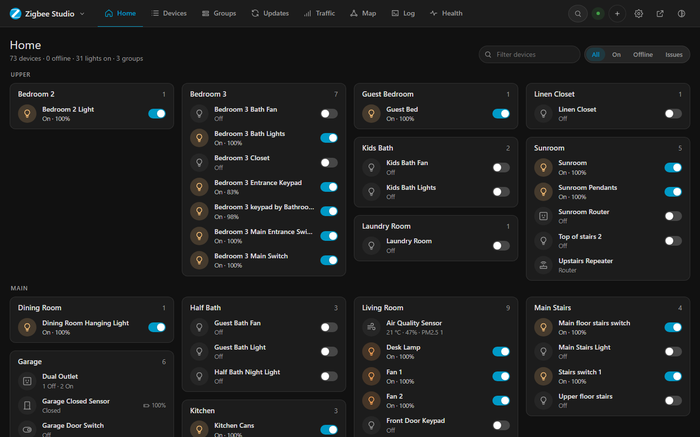
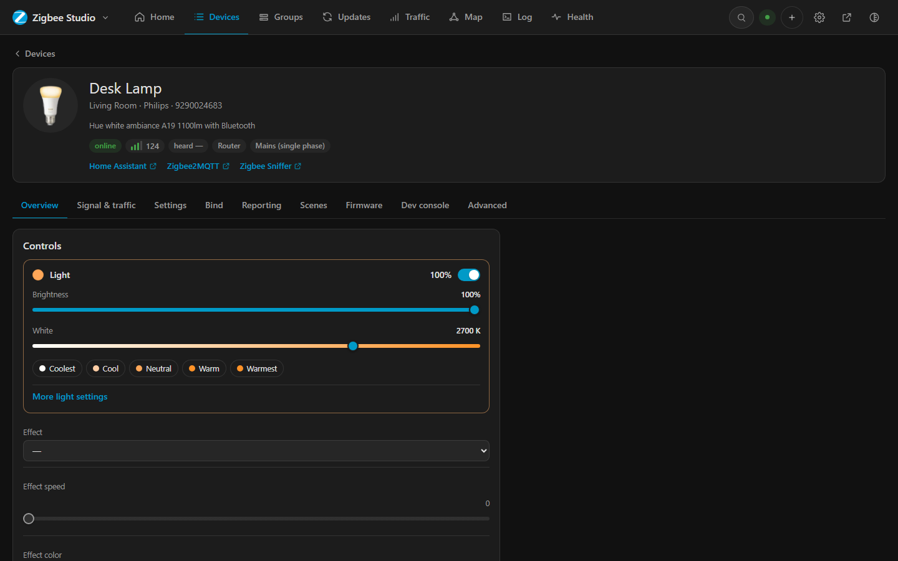
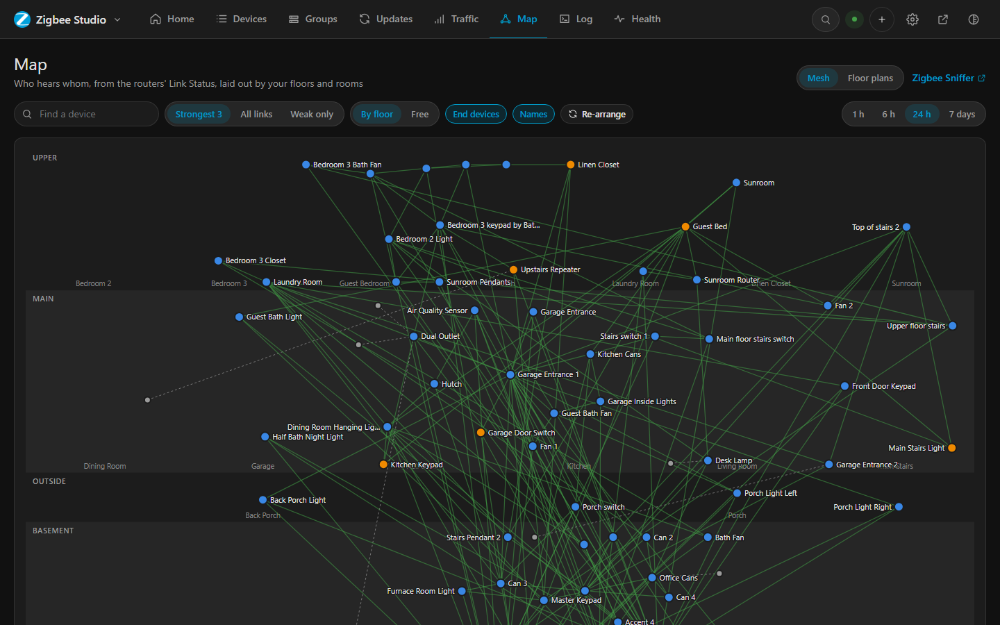

# Zigbee Studio

**A fast, friendly home for your Zigbee devices inside Home Assistant.**

Zigbee Studio is a new web page for [Zigbee2MQTT](https://www.zigbee2mqtt.io/). It shows every
device by floor and room, updates live, and opens instantly, even with a hundred devices. It runs
next to Zigbee2MQTT's own page, so you can switch between the two whenever you like; nothing about
your Zigbee2MQTT setup changes.

## What you can do with it

- **See your whole network at a glance**, laid out by the floors and rooms you already set up in
  Home Assistant, with lights, switches and sensors you can use right there.
- **Open any device** for everything it can do: its controls, every setting, bindings, reporting,
  scenes, firmware updates, and a console for the curious.
- **Manage groups, pair new devices and update firmware** without leaving the page.
- **Keep an eye on health**: what's offline, what's weak, what changed, and Zigbee2MQTT's live log.
- **Change Zigbee2MQTT's settings** safely. The ones that could break your network (channel, network
  key and the like) are locked.
- **Look deeper with a [Zigbee Sniffer](https://github.com/home-controls/zigbee-sniffer)**: signal and
  traffic history per device, a live view of what's on the air, a map of who hears whom, and floor
  plans with coverage.
- **Check on a [Zigbee Bridge](https://github.com/home-controls/zigbee-bridge)** if your coordinator
  sits on the network.

It starts **read-only**: you can look at everything, but nothing changes until you switch on
*Allow control* in the add-on's settings.

| A device | The mesh map |
| --- | --- |
|  |  |

## What you need

- Home Assistant OS or Supervised (anything that runs add-ons)
- The **Zigbee2MQTT** add-on, set up and working

That's all. The Zigbee Sniffer and Zigbee Bridge are optional extras.

## Install

1. Click the **Add repository** button at the top of this page (or in Home Assistant go to
   *Settings → Add-ons → Add-on store → ⋮ → Repositories* and add
   `https://github.com/home-controls/zigbee-studio`).
2. Find **Zigbee Studio** in the store and click **Install**.
3. Click **Start**, and turn on **Show in sidebar**.

Open it from the sidebar. It finds Zigbee2MQTT by itself.

When you're ready to control devices from it, go to the add-on's **Configuration** tab, switch on
**Allow control**, and restart the add-on.

## Questions

**Does it replace Zigbee2MQTT's own page?** No. Both keep working side by side. Zigbee Studio talks
to Zigbee2MQTT the same way its own page does, as one more visitor.

**Will it change my Zigbee2MQTT configuration?** Only when you save a setting yourself, and never
the settings that could disconnect your devices.

**Is it really faster?** Yes. The page is several times smaller than Zigbee2MQTT's own, and after
the first load it only receives what changed, so a big network opens in a blink.

**Where's the full guide?** In [the add-on's documentation](zigbee_studio/DOCS.md), which Home
Assistant also shows on the add-on's page.

## The Zigbee family

Zigbee Studio is one of three apps that share one look, so moving between them feels like moving
between pages of one app:

| | |
| --- | --- |
| **Zigbee Studio** | This one: a fast page for Zigbee2MQTT |
| [Zigbee Sniffer](https://github.com/home-controls/zigbee-sniffer) | Listen to your network with small ESP32 radios to see what's really happening |
| [Zigbee Bridge](https://github.com/home-controls/zigbee-bridge) | Put your Zigbee coordinator on Ethernet, wherever reception is best |

## For developers

How it works, how to run it on a PC with a simulator, and how releases are made:
[`zigbee_studio/README.md`](zigbee_studio/README.md). The shared look comes from
[zigbee-ui](https://github.com/home-controls/zigbee-ui).

## License

MIT, see [LICENSE](LICENSE). Zigbee and the Zigbee logo are trademarks of the Connectivity Standards
Alliance; this project is not affiliated with or endorsed by it.
